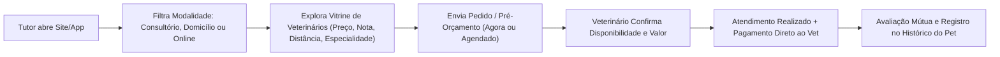
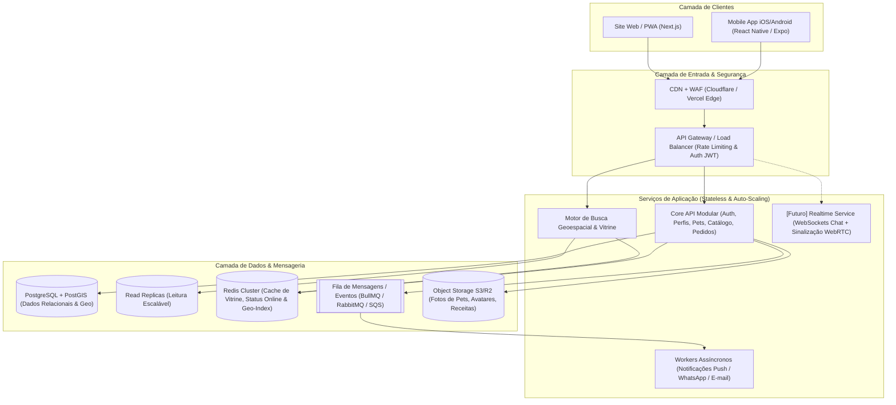

# PRD — Conecta Pet (Plataforma de Conexão entre Tutores e Veterinários)

> **Status do Documento:** Versão 1.0 (Escopo PoC + Arquitetura para Grande Escala)  
> **Data:** Novembro de 2026  
> **Plataformas Alvo:** Web (Site Responsivo / PWA) e Mobile App (iOS & Android)

---

## 1. Visão Geral do Produto

O **Conecta Pet** é uma plataforma estilo marketplace (inspirada na experiência de catálogo/vitrine do **iFood** e na conveniência de serviços sob demanda do **Uber**) que conecta donos de pets (**Tutores**) a **Médicos Veterinários** de forma rápida, intuitiva e sem burocracia.

Os veterinários podem oferecer três modalidades de atendimento:
1. **No Consultório / Clínica Própria** (Presencial)
2. **Visita Domiciliar** (Atendimento na casa do tutor)
3. **Consulta Online** (Telemedicina / Teleorientação veterinária)

### 1.1 Proposta de Valor Central
- **Para o Tutor:** Encontrar rapidamente veterinários próximos ou disponíveis online, comparando preços, avaliações, especialidades, distância e disponibilidade (para atendimento imediato ou agendado), com cadastro em poucos segundos.
- **Para o Veterinário:** Uma vitrine digital gratuita para captar clientes no consultório, em rotas domiciliares ou por teleconsulta, recebendo 100% do valor do atendimento diretamente do tutor.
- **Modelo de Negócio e Monetização:** A plataforma é **100% gratuita para tutores e veterinários** (zero comissão sobre consultas e zero mensalidade). O pagamento do serviço ocorre diretamente entre tutor e veterinário (PIX, cartão na maquininha ou link próprio). A monetização da plataforma será realizada futuramente via **Ads (Publicidade)**, não sendo necessária a implementação do motor de anúncios na fase de PoC.

---

## 2. Dinâmica de Funcionamento (Modelo Catálogo / Vitrine)

Diferente de um sorteio cego, o Conecta Pet opera 100% no modelo **Catálogo/Vitrine (estilo iFood)**:

1. **Descoberta na Vitrine:** O tutor informa sua localização (ou usa o GPS) e seleciona a modalidade desejada (**Consultório**, **Visita Domiciliar** ou **Online**), além de poder filtrar por atendimento **"Disponível Agora"** (plantão) ou **"Agendar Horário"**.
2. **Escolha do Profissional:** O tutor visualiza os cards dos veterinários contendo foto, nome, número do CRMV, especialidades, distância/raio de atendimento, nota média, tempo médio de resposta e preços base para cada modalidade.
3. **Solicitação / Pré-acordo (Escopo PoC vs. Futuro):**
   - **Na PoC:** O tutor seleciona o pet, a modalidade, o horário desejado (ou imediato) e descreve brevemente a necessidade/sintomas. Ao enviar a solicitação (ou acionar o canal de contato prévio), o veterinário confirma se pode atender, alinha eventuais dúvidas/orçamento (ex: taxa de deslocamento ou vacinas extras) e ambos coordenam o atendimento (via handoff controlado para WhatsApp/link de vídeo externo ou mensagem simples no pedido).
   - **No Futuro (Fase 2+):** Chat em tempo real com envio de mídia, chamada de vídeo nativa (WebRTC) dentro do próprio App/Site e rastreio geográfico em tempo real do deslocamento do veterinário nas visitas domiciliares.
4. **Pagamento Direto:** O acerto financeiro é feito diretamente entre o tutor e o veterinário (PIX, dinheiro ou cartão direto com o profissional), sem intermediação financeira pelo app.
5. **Conclusão e Avaliação:** Após o atendimento, o status do pedido é marcado como concluído e o tutor avalia o veterinário (1 a 5 estrelas + comentário), alimentando o ranking da vitrine.

---

## 3. Perfis de Usuário e Personas

| Perfil | Descrição | Objetivos Principais |
| :--- | :--- | :--- |
| **Tutor (Dono de Pet)** | Donos de cães, gatos e pets exóticos que buscam atendimento rápido, transparente e confiável. | Cadastrar-se sem fricção, achar um bom veterinário perto de casa ou online, saber o preço antes e resolver o problema do pet. |
| **Médico Veterinário** | Profissionais autônomos (volantes/domiciliares), plantonistas de telemedicina ou donos de consultórios. | Cadastrar seu perfil rapidamente, configurar modalidades/preços/agenda, ligar/desligar o botão "Disponível Agora" e receber pedidos. |
| **Administrador (Backoffice)** | Equipe de operação da plataforma. | Validar registros profissionais (CRMV), moderar avaliações/denúncias e acompanhar métricas de uso. |

---

## 4. Escopo Funcional: PoC (MVP) vs. Evolução Futura

Para garantir entregas rápidas sem abrir mão de uma fundação técnica sólida para grande escala, os recursos estão divididos entre **Escopo da PoC (Fase 1)** e **Roadmap Futuro (Fase 2+)**.

### 4.1 Módulo do Tutor (App & Site)

| Funcionalidade | Escopo PoC (Fase 1) | Evolução Futura (Fase 2+) |
| :--- | :--- | :--- |
| **Cadastro & Login Fácil** | Login Social (Google/Apple) ou Telefone/E-mail com código OTP (sem formulários longos). | Autenticação biométrica (Passkeys) e recuperação avançada. |
| **Cadastro de Pets** | Cadastro simplificado (Nome, Espécie, Raça, Idade, Peso e Observação rápida), podendo cadastrar apenas na hora de pedir. | Carteira digital completa de vacinação, alertas de vermífugo e prontuário unificado. |
| **Busca e Vitrine (Estilo iFood)** | Busca geolocalizada por raio (km), filtros por modalidade (Consultório, Domicílio, Online), especialidade, preço, nota e selo "Disponível Agora". | Recomendações personalizadas por IA, busca elástica com sinônimos de sintomas. |
| **Solicitação / Orçamento Prévio** | Envio de pedido de atendimento com descrição do caso + canal direto de confirmação/contato com o veterinário antes do fechamento. | Chat nativo completo em tempo real (WebSockets) com envio de fotos, vídeos e áudios dentro do app. |
| **Atendimento Online** | Agendamento/solicitação na plataforma e realização da videochamada via link externo informado pelo vet (Meet/WhatsApp). | Sala de vídeo nativa (WebRTC) integrada ao App/Site com prescrição digital assinada (ICP-Brasil). |
| **Visita Domiciliar** | Cálculo de raio de cobertura do vet, exibição da taxa base de deslocamento e status do pedido ("Aceito", "A caminho", "Concluído"). | Rastreamento em tempo real do veterinário no mapa (estilo Uber/iFood) durante o deslocamento. |
| **Avaliações e Favoritos** | Nota de 1 a 5 estrelas, comentário pós-consulta e lista de veterinários favoritos. | Avaliações verificadas com tags rápidas ("Pontual", "Carinhoso com o pet", "Preço justo"). |

### 4.2 Módulo do Veterinário (App & Painel Web)

| Funcionalidade | Escopo PoC (Fase 1) | Evolução Futura (Fase 2+) |
| :--- | :--- | :--- |
| **Onboarding Ágil** | Cadastro em 3 passos: (1) Dados básicos/Login, (2) Número do CRMV + UF e especialidades, (3) Modalidades atendidas e preços base. | Validação automatizada de CRMV e upload de certificados de pós-graduação/especialidade. |
| **Configuração de Modalidades** | Ativar/desativar independentemente: **Consultório** (com endereço fixo), **Domicílio** (com raio máximo em km e taxa) e **Online**. | Configuração de polígonos de bairros atendidos e tabela dinâmica de frete/deslocamento por km. |
| **Status "Disponível Agora"** | Botão *Toggle* rápido ("Online para Plantão / Atendimento Imediato") estilo Uber/iFood para aparecer no topo das buscas urgentes. | Pausas programadas e fila inteligente de múltiplos chamados simultâneos. |
| **Gestão de Solicitações** | Painel de pedidos recebidos (Pendentes, Confirmados, Histórico) com ações de Aceitar/Recusar e botão rápido para contatar o tutor. | Agenda completa integrada (Google Calendar), prontuário eletrônico do paciente e receituário digital. |

### 4.3 Módulo de Monetização (Ads)
- **Escopo PoC (Fase 1):** Não será implementado. Foco 100% em aquisição, retenção e liquidez do marketplace (tutores e veterinários).
- **Evolução Futura (Fase 2+):** Ad Server próprio e integração com redes programáticas (Google AdMob/AdSense), banners patrocinados para marcas pet, farmácias e petshops, além de posições patrocinadas ("Veterinário em Destaque" estilo iFood Ads).

---

## 5. Requisitos de UX/UI ("Fácil de Cadastrar e de Usar")

1. **Exploração sem Login Obrigatório (Guest Mode):** O tutor pode abrir o site ou o app, informar seu CEP/localização e navegar por toda a vitrine de veterinários, ver preços e avaliações **sem precisar criar conta primeiro**. O login/cadastro só é solicitado no momento de contatar ou enviar o pedido ao veterinário.
2. **Onboarding Progressivo:**
   - O cadastro inicial do tutor pede apenas Nome e Telefone/Google.
   - Os dados do pet são preenchidos em menos de 15 segundos (Nome + Espécie: Cachorro/Gato/Outro) no momento do primeiro pedido.
3. **Clareza Visual estilo iFood:**
   - Cards limpos com badges claros das 3 modalidades: 🏥 *Consultório*, 🚗 *Domicílio*, 💻 *Online*.
   - Indicador verde pulsante (**"Atendendo Agora"**) para veterinários com plantão ativo.
   - Transparência de valores: exibir claramente *"Consulta a partir de R$ XX"* e *"Taxa domiciliar: R$ YY"*.

---

## 6. Arquitetura de Backend para Grande Escala

Mesmo iniciando como uma PoC funcional, o backend deve ser projetado desde o Dia 1 com princípios de **alta escalabilidade, baixa latência em buscas geoespaciais e desacoplamento**, suportando crescimento para milhões de tutores e dezenas de milhares de veterinários simultâneos sem necessidade de reescrita completa.

### 6.1 Diagrama de Arquitetura (Visão Alvo & Fundação Escalável)

### 6.2 Pilares de Escalabilidade do Backend

1. **Arquitetura Modular (Monólito Modular -> Microsserviços):**
   - Iniciar com um **Monólito Modular Stateless** (em Node.js/TypeScript com NestJS ou Fastify, ou Go) dividido em domínios claros (`auth`, `users`, `pets`, `vets`, `catalog-search`, `bookings`, `reviews`, `notifications`).
   - Por ser **100% stateless**, permite escalar horizontalmente de 1 para $N$ instâncias atrás de um Load Balancer instantaneamente, e extrair módulos críticos (como `catalog-search` ou `realtime-chat`) para microsserviços independentes conforme o tráfego crescer.

2. **Busca Geoespacial de Alta Performance (Estilo iFood/Uber):**
   - **PostgreSQL + PostGIS:** Armazenamento persistente das coordenadas de consultórios e áreas de cobertura domiciliar com índices espaciais (`GIST` sobre colunas `GEOGRAPHY`).
   - **Redis Geo / H3 Index (Cache de Baixa Latência):** O status **"Disponível Agora"** (heartbeat do veterinário) e a listagem da vitrine por região (células geográficas / CEP) ficam cacheados no **Redis** com TTL curto (ex: 30 a 60 segundos), garantindo respostas de vitrine em `< 50ms` mesmo em horários de pico.

3. **Leitura vs. Escrita (CQRS Leve & Read Replicas):**
   - Em marketplaces estilo iFood, a proporção de leitura (tutores navegando na vitrine) para escrita (criação de pedidos) é de cerca de **95% leitura / 5% escrita**.
   - As consultas de vitrine utilizam cache agressivo (Redis) e réplicas de leitura do banco de dados, protegendo o banco primário para operações transacionais de pedidos e cadastros.

4. **Processamento Assíncrono Baseado em Eventos:**
   - Envio de notificações Push (FCM/APNs), e-mails, alertas de novos pedidos para o veterinário, recálculo de nota média de avaliações e telemetria nunca bloqueiam a requisição HTTP do usuário; são despachados via fila assíncrona (Redis/BullMQ ou AWS SQS).

5. **Armazenamento de Mídia Desacoplado:**
   - Upload de fotos de perfil, fotos dos pets e documentos utiliza **Presigned URLs** direto do App/Site para o Object Storage (AWS S3 / Cloudflare R2), evitando tráfego de arquivos pesados pelos servidores da API.

---

## 7. Modelo de Dados Essencial (Core Schema)

Abaixo estão as entidades principais que sustentam a PoC e já preparam o banco para grande escala:

- **`users`**: `id (UUIDv7)`, `role (TUTOR | VET | ADMIN)`, `name`, `email`, `phone`, `avatar_url`, `auth_provider`, `created_at`
- **`pets`**: `id`, `tutor_id (FK)`, `name`, `species (DOG | CAT | EXOTIC | OTHER)`, `breed`, `birth_date`, `weight_kg`, `notes`
- **`vet_profiles`**: `id`, `user_id (FK)`, `crmv_number`, `crmv_state`, `bio`, `specialties (JSONB/Array)`, `is_verified`, `is_online_now (Boolean)`, `rating_avg`, `rating_count`, `whatsapp_phone`
- **`vet_service_modalities`**:
  - `vet_id (FK)`
  - `modality (CLINIC | HOME_VISIT | ONLINE)`
  - `is_active (Boolean)`
  - `base_price_cents (Integer)`
  - `displacement_fee_cents (Integer, nullable)`
  - `coverage_radius_km (Integer, nullable)`
  - `clinic_address (JSONB, nullable)`
  - `location_point (PostGIS GEOGRAPHY(Point, 4326))`
- **`service_requests` (Pedidos / Orçamentos)**:
  - `id (UUIDv7)`, `tutor_id (FK)`, `pet_id (FK)`, `vet_id (FK)`
  - `modality (CLINIC | HOME_VISIT | ONLINE)`
  - `urgency_type (IMMEDIATE | SCHEDULED)`
  - `scheduled_for (Timestamp, nullable)`
  - `status (PENDING_QUOTE | ACCEPTED | REJECTED | COMPLETED | CANCELLED)`
  - `symptoms_description (Text)`
  - `agreed_price_cents (Integer, nullable)`
  - `tutor_location_point (GEOGRAPHY, nullable)`
  - `external_meeting_link (String, nullable)`
  - `created_at`, `updated_at`
- **`reviews`**: `id`, `service_request_id (FK Unique)`, `tutor_id`, `vet_id`, `rating (1..5)`, `comment`, `created_at`

> [!TIP]
> **Uso de `UUIDv7` como chave primária:** Diferente do `UUIDv4` aleatório que fragmenta índices B-Tree em bancos grandes, o `UUIDv7` é ordenado temporalmente (time-sortable), garantindo alta performance de inserção em PostgreSQL em grande escala.

---

## 8. Stack Tecnológica Recomendada

Para compartilhar código entre Site e App, acelerar a PoC e manter altíssima escalabilidade no backend:

| Camada | Tecnologia Recomendada | Justificativa |
| :--- | :--- | :--- |
| **Linguagem Principal** | **Python 3.10+** | Ecossistema maduro, tipagem gradual (`typing`), alta produtividade e suporte nativo a concorrência e geolocalização. |
| **Backend & Web SSR** | **Python Stateless HTTP / ASGI (FastAPI / Uvicorn ou `ThreadingHTTPServer`)** | Baixa latência, fácil escalabilidade horizontal em múltiplos workers/containers e renderização unificada Web + API JSON. |
| **Banco de Dados** | **PostgreSQL 16+ (com suporte espacial PostGIS / Haversine)** | Padrão ouro para consultas relacionais combinadas com busca geoespacial por raio e distância. |
| **Cache & Filas** | **Geo-Cell TTL Cache (Redis Cluster)** + **Async Worker Queue (Celery / RQ)** | Cache de vitrine geoespacial por célula, controle de presença online dos veterinários e jobs assíncronos em background. |
| **Infra & Deploy** | **Containers Python Stateless + PostgreSQL Multi-AZ** | Auto-scaling automático baseado em CPU/Requisições com custo baixo na fase de PoC e escala elástica em produção. |

---

## 9. Requisitos Não-Funcionais (Segurança, Performance e LGPD)

1. **Performance de Busca:** A listagem da vitrine de veterinários (filtrada por localização e modalidade) deve responder em `< 200ms` no percentil 95 (p95).
2. **Disponibilidade (SLA):** Arquitetura sem ponto único de falha (Stateless API + Multi-AZ Database), mirando `99.9%` de uptime em produção.
3. **Segurança e Anti-Spam:**
   - Rate limiting por IP e por usuário no API Gateway para evitar scraping da base de veterinários e spam de pedidos falsos.
   - O número de WhatsApp/telefone direto do tutor só é exibido ao veterinário quando há uma solicitação ativa, e vice-versa.
4. **Conformidade Legal (LGPD & CFMV):**
   - Consentimento explícito dos termos de uso (deixando claro que a plataforma atua como classificados/conector tecnológico e que o ato médico e a cobrança financeira são de responsabilidade direta do Médico Veterinário inscrito no CRMV).

---

## 10. Roadmap de Implementação

### Fase 1: PoC Funcional (Foco Atual)
- [ ] Setup do Monorepo (Web + Mobile + Backend API + Banco PostgreSQL/PostGIS).
- [ ] Autenticação simplificada (Tutor e Veterinário) e modo visitante na vitrine.
- [ ] Cadastro de Perfil do Veterinário (CRMV, especialidades, endereço/raio e configuração das 3 modalidades: Consultório, Domicílio e Online).
- [ ] Vitrine Geolocalizada estilo iFood com filtros por modalidade, distância, preço, avaliação e botão "Disponível Agora".
- [ ] Fluxo de Solicitação / Pré-orçamento com descrição dos sintomas do pet, aceite do veterinário e handoff para atendimento/pagamento direto.
- [ ] Sistema de conclusão de atendimento e avaliação (1 a 5 estrelas).

### Fase 2: Retenção e Comunicação Nativa
- [ ] Chat em tempo real dentro do App/Site (WebSockets) para o pré-orçamento e envio de fotos/exames do pet.
- [ ] Telemedicina integrada com chamada de vídeo nativa (WebRTC) dentro da plataforma.
- [ ] Rastreamento em tempo real no mapa (estilo Uber) para visitas domiciliares em andamento.
- [ ] Prontuário básico e carteira de vacinação digital do pet.

### Fase 3: Monetização (Ads) e Escala Nacional
- [ ] Integração de espaços publicitários programáticos (AdMob / AdSense).
- [ ] Plataforma de **Conecta Pet Ads** (banners nativos para marcas de ração/medicamentos e impulsionamento opcional na vitrine).
- [ ] Busca avançada com Elasticsearch/Typesense e múltiplas réplicas regionais.
